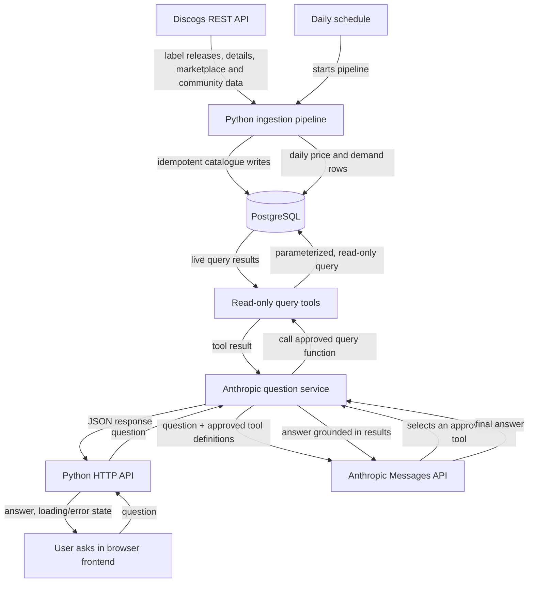

# Music Catalogue Market Trends

[](https://github.com/AntonisKol/music-catalogue-market-trends-wip/actions/workflows/tests.yml)

A step-by-step project for building a pipeline that collects vinyl release data from the Discogs REST API, stores catalogue and daily market snapshots in PostgreSQL, and lets people ask questions about the live dataset in natural language.

The language model does not connect directly to PostgreSQL or invent SQL to run. The application gives it a small set of approved, read-only data tools. The model chooses a tool for a user's question, the application runs a parameterized query, and the model explains the returned data.

**Stack:** Python, PostgreSQL, Docker, Discogs REST API, Anthropic API, and a browser frontend.

## How the app works



The browser sends questions to the Python API; the server calls the Anthropic API on the user's behalf and uses approved read-only tools to query PostgreSQL. PostgreSQL remains the source of truth. The pipeline updates it, and the web app reads it. API keys and database credentials stay on the server and are never sent to the browser.

## Project roadmap: one task at a time

The tasks below are ordered so each step builds on working code from the previous one. Start with **Task 1** and do not start a blocked task early. Every task has a corresponding issue on the [GitHub project board](https://github.com/users/AntonisKol/projects/3), where priority and blocker links are tracked.

| Step | Issue | Priority | Status | What you'll build |
| --- | --- | --- | --- | --- |
| 1 | [#5 Persist Discogs vinyl release data in PostgreSQL](https://github.com/AntonisKol/music-catalogue-market-trends-wip/issues/5) | P0 | Done | A Python/psycopg repository that maps Discogs records to the existing tables and writes them safely and repeatedly. |
| 2 | [#2 Test Discogs ingestion and PostgreSQL pipeline](https://github.com/AntonisKol/music-catalogue-market-trends-wip/issues/2) | P0 | Done | Automated tests for API handling and database mapping/upserts, using mocked HTTP and a test database. |
| 3 | [#3 Capture daily vinyl price and demand snapshots](https://github.com/AntonisKol/music-catalogue-market-trends-wip/issues/3) | P0 | Done | Fetch market supply/price and community demand, then store one snapshot per release per day. |
| 4 | [#6 Build a repeatable Discogs-to-PostgreSQL ingestion pipeline](https://github.com/AntonisKol/music-catalogue-market-trends-wip/issues/6) | P0 | Done | A Python command that connects label pagination, release detail fetching, catalogue writes, and snapshot writes. |
| 5 | [#10 Schedule and operate daily ingestion](https://github.com/AntonisKol/music-catalogue-market-trends-wip/issues/10) | P2 | Done | Run the pipeline daily, avoid overlapping runs, and document logs, failures, and safe retries. |
| 6 | [#11 Add safe read-only query tools for the live dataset](https://github.com/AntonisKol/music-catalogue-market-trends-wip/issues/11) | P1 | Done | A restricted database role and a small set of parameterized query functions for release lookup and price/demand comparisons. |
| 7 | [#7 Add Anthropic-powered natural-language queries over live data](https://github.com/AntonisKol/music-catalogue-market-trends-wip/issues/7) | P1 | Done | Use Anthropic tool use: the model selects an approved Python query tool, the app executes it, and the model explains the live results. |
| 8 | [#9 Test the Anthropic query service and guardrails](https://github.com/AntonisKol/music-catalogue-market-trends-wip/issues/9) | P1 | Done | Test the assistant service, tool selection, read-only behavior, query limits, and grounded answers without live API calls. |
| 9 | [#8 Expose natural-language questions through a Python web API](https://github.com/AntonisKol/music-catalogue-market-trends-wip/issues/8) | P1 | Done | Add a validated HTTP/JSON endpoint for the browser to call; keep Anthropic and database credentials server-side. |
| 10 | [#12 Build the natural-language question web frontend](https://github.com/AntonisKol/music-catalogue-market-trends-wip/issues/12) | P1 | Done | Build the user-facing question form and answer view, including loading, validation, and error states. |
| 11 | [#13 Test web question frontend and accessibility](https://github.com/AntonisKol/music-catalogue-market-trends-wip/issues/13) | P1 | Todo | Test the browser experience, API integration, keyboard interaction, focus, and accessibility announcements. |

### What each task teaches

1. **Persist records — Python, psycopg, PostgreSQL.** Follow one Discogs response into the database. Separate API response mapping from SQL, respect foreign-key order, and use `INSERT ... ON CONFLICT` so rerunning ingestion updates records instead of duplicating them.
2. **Test ingestion — unittest/pytest, mocks, PostgreSQL.** Test the mapping and failure paths without making live Discogs requests. Use a disposable test database for SQL behavior; never point tests at valuable local data.
3. **Capture snapshots — Discogs REST API, Python, PostgreSQL.** Use the relevant release and marketplace/community endpoints, map only available fields, and use the schema's `(release_id, snapshot_date)` uniqueness to make a daily run repeatable.
4. **Build the pipeline command — Python CLI.** Compose existing small functions rather than putting the whole workflow in one function: list label releases, fetch details, write catalogue data, then write snapshots. Surface API and database errors instead of hiding them.
5. **Schedule daily ingestion — scheduler, Docker, logs.** Reuse the same ingestion command on a schedule. Make failures visible and retries safe; scheduling is separate from the pipeline so local development remains simple.
6. **Add safe query tools — PostgreSQL permissions, parameterized SQL.** Give the question feature a read-only database role. Implement narrowly scoped functions with parameters and bounded results; do not execute SQL text supplied by a user or generated by a model.
7. **Connect Anthropic — Anthropic Messages API, tool use.** Send the question and descriptions of the approved tools. When the model requests a tool, validate its input, call the matching Python function, return the result to the model, and produce a data-grounded answer. Keep the API key in an environment variable.
8. **Test the question service — Python tests, mocks.** Mock Anthropic responses and database tools. Confirm unsupported questions and failures are handled clearly, tool arguments are validated, results are bounded, and generated text cannot change database data.
9. **Expose the question service — Python HTTP API.** Accept a validated question and return a clear JSON response. Keep API keys on the server and return safe, useful error responses.
10. **Build the frontend — HTML, CSS, and JavaScript.** Create the browser form, example questions, answer display, and loading/error states. Use `fetch` to call the Python API; the browser never connects directly to PostgreSQL or Anthropic.
11. **Test the frontend — browser and accessibility checks.** Verify submission and response states against a mocked API, then test keyboard use, accessible labels, focus, and screen-reader status announcements.

## What's already implemented

- PostgreSQL schema for labels, artists, releases, release/artist relationships, and daily price and demand snapshots.
- Docker Compose configuration for PostgreSQL 16; the schema initializes on first database creation.
- Discogs client functions for fetching a release and paginating through a label's release summaries.
- Saving one release to PostgreSQL: its label, artists and the release itself, written in one transaction with repeatable upserts (`python -m ingestion.save_release <id>`).
- A daily price and demand snapshot per release: lowest price (always in EUR) and copies for sale, plus want, have and rating, one row per release per UTC day (`python -m ingestion.save_snapshot <id>`).
- Ingesting a whole label: every vinyl release on it and today's snapshot of each, with paced requests, retries for temporary Discogs errors, timestamped progress and a summary of any failures (`python -m ingestion.ingest_label <label_id>`).
- A read-only database login for the question feature, and five validated, capped query tools in `queries/tools.py`: `search_releases`, `rank_releases`, `release_history`, `market_changes` and `compare_labels` (see [Query the data read-only](#query-the-data-read-only)).
- Automated tests for the Discogs client, the mapping, saving releases and snapshots to PostgreSQL, the commands, the reader login and the query tools, run by GitHub Actions on every pull request (see [Run the tests](#run-the-tests)). Diagrams of the whole system, the task map and the problems solved so far are in [docs/architecture.md](docs/architecture.md).

- A question service: Claude Haiku 5.5 picks among the five query tools, our code runs them through the read-only login, and the answer comes back with the rows it is based on (see [Ask a question](#ask-a-question)).

- A web API (`POST /api/questions`) in front of the question service, with a human check, limits per visitor, per account and for the whole site, and JSON errors (see [Run the web API](#run-the-web-api)).
- Sign-up with an email address and a password, confirmed by a link in an email, for a larger quota; accounts can be deleted (see [Signing up](#signing-up)).
- A question box for adnsaudio.com: one JavaScript module and one stylesheet in [`widget/`](widget) (see [Add the question box to a page](#add-the-question-box-to-a-page)).

- A nightly update of every tracked label, with a record of each run and a log of any problems (see [Update the data every night](#update-the-data-every-night)). Prices are fetched every night; want, have and ratings once a week per release.

- Everything ready to run on a server: the database, the API behind HTTPS, the nightly update, nightly backups copied off the server, and one deploy command (see [Run it on a server](#run-it-on-a-server)).

## Requirements

- Docker with Compose
- Python 3.10 or newer. The pinned libraries do not install on older versions, and macOS's built-in `python3` is 3.9: check with `python3 --version`, and if needed install a newer one (for example `brew install python@3.12`, then use `python3.12` below)
- A [Discogs personal access token](https://www.discogs.com/settings/developers)
- An [Anthropic API key](https://console.anthropic.com/) for the natural-language question feature

## Set up the current project

From the repository root, create a `.env` file. Compose and the Python client read these values:

```dotenv
DISCOGS_TOKEN=your_personal_access_token
DISCOGS_USER_AGENT=MusicCatalogueMarketTrends/0.1 +https://github.com/AntonisKol/music-catalogue-market-trends-wip
ANTHROPIC_API_KEY=your_anthropic_api_key
POSTGRES_HOST=localhost
POSTGRES_PORT=5432
POSTGRES_USER=catalogue
POSTGRES_PASSWORD=catalogue
POSTGRES_DB=catalogue
POSTGRES_READER_USER=catalogue_reader
POSTGRES_READER_PASSWORD=choose_a_different_password
POSTGRES_LIMITS_USER=catalogue_limits
POSTGRES_LIMITS_PASSWORD=choose_another_password
TURNSTILE_SECRET_KEY=1x0000000000000000000000000000000AA
VISITOR_HASH_SECRET=a_long_random_string
```

`DISCOGS_USER_AGENT` must identify this app. Discogs rejects generic clients. Use your own token and password; these values are examples for local development, not production credentials. Do not commit `.env`.

Start PostgreSQL. On the first start, Docker applies `db/schema.sql` automatically:

```bash
docker compose up -d
docker compose exec db psql -U catalogue -d catalogue -c '\dt'
```

Create a Python environment and install dependencies:

```bash
python3 -m venv .venv
source .venv/bin/activate
pip install -r requirements.txt
```

Fetch one release using the current API client:

```bash
python - <<'PY'
from ingestion.discogs_client import get_release

release = get_release(249504)
print(release["title"], release.get("year"))
PY
```

To fetch a label's release summaries, replace `12345` with a Discogs label id:

```bash
python - <<'PY'
from ingestion.discogs_client import get_label_releases

summaries = get_label_releases(12345)
print(len(summaries), summaries[0]["id"], summaries[0]["title"])
PY
```

The label endpoint returns summaries, not the full release records needed by the database; the ingestion pipeline below fetches each release's details before writing it. Every Discogs request is paced at least 1.1 seconds apart, to stay under the authenticated limit of 60 a minute. A large catalogue can take a while.

Save one release, with its label and artists, to PostgreSQL:

```bash
python -m ingestion.save_release 249504
```

It prints the saved release, for example `Saved 249504: Rick Astley - Never Gonna Give You Up (1987) on RCA`. Running it again updates the same rows instead of adding duplicates. If Discogs or the database fails, it prints what went wrong, keeps nothing from the failed save, and exits with status 1.

Save today's price and demand snapshot of a release (the release itself is saved or updated first):

```bash
python -m ingestion.save_snapshot 249504
```

It prints, for example, `Snapshot of 249504 on 2026-11-01 (UTC): 124 for sale from 0.59 EUR; want 594, have 4159; rated 3.88 by 249`. Prices come from Discogs' marketplace statistics and are always requested in EUR. "Today" is the UTC date, and running it again on the same day replaces that day's values. A release with nothing for sale is stored with no price, and one nobody has rated with no average (shown as "not rated"), rather than as 0.

Ingest a whole label: every vinyl release on it, and today's snapshot of each:

```bash
python -m ingestion.ingest_label 800000
```

Progress is logged with timestamps, one line per release, for example `[1/11] 1832937 saved: 38 for sale from 2.99 EUR; want 39, have 328; rated 2.54 by 35`, and the run ends with a summary such as `Label 2 done: 27 listed, 23 saved, 4 not vinyl, 0 not on this label, 0 gone, 0 failed`. It takes about 2 seconds per vinyl release, so a label with 500 releases takes roughly 15 minutes.

- **Vinyl only.** Releases whose list entry is clearly CD, file, cassette or video are skipped without a request. Every other release is kept only if its details include the format "Vinyl". Releases listed twice are ingested once.
- **Issued on the label, not just credited.** A label's Discogs list also holds releases where it only appears in a credit, such as a studio under "Recorded At". Those are skipped as "not on this label". A co-release is still stored under its first label only.
- **Failures.** Rate limits (429), Discogs server errors and dropped connections are retried after 5, 15 and 60 seconds. Anything still failing, malformed data included, is logged for that release, and the run carries on with the rest. At the end every failed release is listed, and the command exits with status 1. If the database connection is lost, the run stops at once.
- **Gone releases.** A release still on the label's list that Discogs no longer has (404) is logged as a warning and listed as gone. It does not fail the run.
- **One run at a time.** A second run refuses to start while another one is in progress, since together they would exceed Discogs' rate limit. It exits with status 1.
- **Safe to rerun.** Each release is committed as soon as it is saved, so an interrupted run keeps what it finished. Running it again the same day updates the same rows.

## Update the data every night

The labels to update live in the `tracked_labels` table. An existing database gets the new tables with one command, which is safe to run again and leaves existing data alone:

```bash
python -m ingestion.apply_schema
```

Choose the labels by their Discogs label id (the number in a label's Discogs address):

```bash
python -m ingestion.track_labels add 1 538     # Planet E, Perlon
python -m ingestion.track_labels list
python -m ingestion.track_labels pause 538     # skip it at night, keep its data
python -m ingestion.track_labels resume 538
```

**Labels visitors ask for.** Signed-in visitors can ask for a label from the question box, by name. A request alone tracks nothing: you review it and decide.

1. **You get an email.** Every 15 minutes, cron checks for new requests in the admin container and emails each one to `LABEL_REQUEST_EMAIL`, with the labels Discogs finds under that name, their size and links, and the commands to decide. Equivalent names ("Polegroup", "polegroup records") are one request.
2. **You decide from your Mac,** in the project folder. The script logs in to `DEPLOY_SERVER` (from your `.env`) and runs the command in the admin container there:

   ```bash
   sh scripts/label-requests list                              # open requests, with how many accounts asked
   sh scripts/label-requests review 3                          # the Discogs matches; visitors see "being reviewed"
   sh scripts/label-requests approve 3 21250                   # or the label's discogs.com link
   sh scripts/label-requests reject 3 "Not a techno label."
   ```

3. **Approving** tracks the label and starts importing it on the server at once (progress in `logs/import-<label>.log`). After that the nightly run keeps it up to date.
4. **Rejecting** emails your reason to everyone who asked. If an email fails, the next 15-minute check sends it again.

The box shows each visitor where their requests stand: waiting for review, being reviewed, added, or rejected with your reason. Discogs' search can miss a label; then find it on discogs.com and approve with the number in its address.

**Asking for a label.** Signed in, a visitor can request a label the site doesn't track: `POST /api/label-requests` with `{"name"}` stores it for you to review, and `GET /api/label-requests` lists the visitor's own requests with their status (`waiting`, `reviewing`, `added` or `rejected`, with your `reason`). A label that is already tracked gets a `tracked` answer and no request; if the tracked labels can't be read, the request is refused rather than stored. Requests are limited to 3 a day per account and 50 a day for the site, and are deleted with the account. The web API never calls Discogs; your review command does.

The emails carry the ADNS Audio logo from [`web/assets/`](web/assets) inside the message, because many mail apps block images fetched from the web.

The cookie works on the live site only if the API is on a subdomain of adnsaudio.com, such as `api.adnsaudio.com` (see [Run it on a server](#run-it-on-a-server)).

## Add the question box to a page

The question box is plain HTML, CSS and JavaScript, with no framework and no build step:
- [`widget/ask.js`](widget/ask.js), the box;
- [`widget/ask.css`](widget/ask.css), its look, which picks up adnsaudio.com's own colour and font variables;
- [`widget/index.html`](widget/index.html), a demo page.

To put it on a page, copy the two files next to it and add:

```html
<link rel="stylesheet" href="ask.css">
<div class="mt-ask" data-api="https://API-ADDRESS" data-turnstile-sitekey="YOUR-TURNSTILE-SITE-KEY"></div>
<script src="https://challenges.cloudflare.com/turnstile/v0/api.js?render=explicit" async defer></script>
<script type="module" src="ask.js"></script>
```

The page's address must be in the API's `ALLOWED_ORIGINS`. The Turnstile *site* key is public and belongs in the page. Its *secret* key stays in the API's `.env`.

What the box does:
- lists the labels the site tracks, read live from the API, and leaves the list out if it can't be loaded;
- shows example questions and a character count up to 500. The human check is invisible: Cloudflare shows its box only if it is unsure about a visitor;
- disables the button while a question is answered, so a double click sends one question;
- shows the answer, any warning, and "Show the data" with the rows behind it, opened automatically when there is a warning;
- names the model that answered;
- shows how many questions are left, offers sign-up when the anonymous allowance runs out, and shows the signed-in address with a **Verified** badge, **Sign out** and **Delete my account**;
- turns errors and limits into plain messages ("You can ask again in about 30 minutes").

After signing up or in, it asks the browser to save the password where the browser allows that (Chrome and Edge), and remembers in that browser that the visitor has an account, so the form opens on **Sign in** next time and offers the saved password. It says where questions go, and links to the site's privacy page at `/privacy/`.

Answers are rendered from a small Markdown subset (paragraphs, bold, italic, lists, tables) using text nodes only, so nothing in an answer can run as code.

To try it locally, use two terminal windows. In the first, start the API on port 5050 with Cloudflare's test secret, which always passes, and allow the demo page to call it. The sign-in settings make sign-in links appear in this window instead of being emailed:

```bash
TURNSTILE_SECRET_KEY=1x0000000000000000000000000000000AA ALLOWED_ORIGINS=http://127.0.0.1:8765 \
  EMAIL_LOG_LINKS=true COOKIE_SECURE=false SIGN_IN_RETURN_URL=http://127.0.0.1:8765/ \
  flask --app web.app run --host 127.0.0.1 --port 5050
```

In the second, serve the demo page, which uses the matching test site key and calls `http://127.0.0.1:5050`:

```bash
cd widget && python -m http.server 8765 --bind 127.0.0.1
```

Then open http://127.0.0.1:8765. Port 5000, Flask's default, is taken by AirPlay Receiver on macOS, so a page pointed at it gets "Could not reach the question service".

## Run it on a server

The live setup runs on one small Hetzner server with Ubuntu 24.04. Docker Compose ([`deploy/compose.yml`](deploy/compose.yml)) runs three containers there:

- **db:** PostgreSQL 16, with no port open to the internet.
- **api:** the web API under gunicorn.
- **caddy:** HTTPS for `api.adnsaudio.com`. Caddy gets and renews the certificate by itself.

Cron starts the nightly update at 03:00 UTC and then the backup. The page is part of the website itself. adnsaudio.com is published by GitHub Pages from the [`adns-space`](https://github.com/AntonisKol/adns-space) repo, and the question box lives in its `market-trends/` folder.

### First setup

1. **Server.** In the Hetzner Console, create a server: Ubuntu 24.04, a location in Germany, the smallest shared plan with 4 GB of memory, and your SSH key. Note its IPv4 address.
2. **DNS.** In Cloudflare, add an `A` record `api` pointing to that address, with the proxy off (grey cloud). Caddy needs to answer on it directly to get its certificate, and the API then sees each visitor's real address for the limits. Don't add an `AAAA` (IPv6) record: Docker passes IPv6 visitors on under one shared address, so they would all share one limit.
3. **Prepare the server.** From the project folder on your Mac:
   ```bash
   ssh root@<server-ip> 'sh -s' < deploy/setup-server.sh
   ```
   This installs Docker, turns on the firewall (SSH, 80 and 443 only) and automatic security updates, and creates the user `deploy`, who logs in with your key. It then turns off password and root logins, clones the project to `/srv/market-trends` and installs the cron job. At the end it prints a public key for the backups.
4. **Storage Box.** Order a Storage Box in the Hetzner Console, switch on SSH access, and add the printed key to it ([Hetzner's guide](https://docs.hetzner.com/storage/storage-box/ssh-keys/add-ssh-keys/)).
5. **Turnstile.** In Cloudflare, add a Turnstile widget for `adnsaudio.com` in invisible mode. It gives a public site key and a secret key.
6. **Resend.** Add the domain `adnsaudio.com` in Resend and create the DNS records it lists in Cloudflare. They live on their own subdomain, so the site's existing email forwarding keeps working. Then create an API key, which goes in `RESEND_API_KEY` in the next step.
7. **Settings.** [`deploy/server.env.example`](deploy/server.env.example) lists every setting the server needs. Copy it over and fill it in on the server, taking the database, Discogs and Anthropic values from your Mac's `.env`:
   ```bash
   scp deploy/server.env.example deploy@<server-ip>:/srv/market-trends/.env
   ssh deploy@<server-ip> 'chmod 600 /srv/market-trends/.env && nano /srv/market-trends/.env'
   ```
8. **Load the data.** Copy a dump into `backups/` on the server and load it: the newest one from the Storage Box when rebuilding, or one made from a local database with `docker compose exec -T db sh -c 'pg_dump -U "$POSTGRES_USER" -d "$POSTGRES_DB" --format=custom' > ~/market-trends-$(date +%F).dump`:
   ```bash
   scp ~/market-trends-<date>.dump deploy@<server-ip>:/srv/market-trends/backups/
   ssh -t deploy@<server-ip> 'cd /srv/market-trends && sh deploy/restore.sh backups/market-trends-<date>.dump'
   ```
   The restore asks you to type `yes`, loads everything in one transaction, then sets up the reader and web logins again (a dump does not carry logins) and starts the API.
9. **The page.** Add `DEPLOY_SERVER=deploy@<server-ip>` to your Mac's `.env`. It isn't secret, because the address is public through DNS. Then run the deploy command below, and merge the `adns-space` pull request that swaps the page's "Coming soon" box for the question box. That page holds the live API address and the public Turnstile site key.

### After merging a pull request

```bash
sh deploy/deploy.sh          # the server, then the page
sh deploy/deploy.sh server   # only the API
sh deploy/deploy.sh page     # only the page
```

The command logs in as `deploy` and pulls `main`, then rebuilds and restarts the containers. It also adds any new tables and rights (`apply_schema` and `create_limits_role` are safe to run every time), so nothing has to be run by hand after a merge. It waits until `https://api.adnsaudio.com` answers. Last, it copies `ask.js` and `ask.css` from [`widget/`](widget) into `adns-space/market-trends/` and, if anything changed, opens a pull request on the website. The website's `main` only takes pull requests with passing checks, so merging that pull request is what publishes the page. It uses your usual GitHub login and the `gh` command.

### Looking after it

- **Nightly runs:** `ssh deploy@<server-ip> 'cd /srv/market-trends && docker compose --env-file .env -f deploy/compose.yml run --rm -T admin python -m ingestion.runs'`. The logs are in `/srv/market-trends/logs/`: `nightly.log` for the update, `cron.log` for the backup.
- **Backups:** each night [`deploy/backup.sh`](deploy/backup.sh) writes `backups/market-trends-<date>.dump`. It checks the dump can be read, deletes dumps older than 14 days, and copies the folder to the Storage Box named by `BACKUP_TARGET`. If anything fails, it says so in `logs/cron.log`, and nothing is sent anywhere. Run it by hand with `sh deploy/backup.sh`.
- **Spotting abuse:** the API's log has one line per request: the time, a keyed hash of the visitor's address (the same hash as the question limits), the method, the path, the status and the browser name. It never holds the address. Container logs are limited to three files of 10 MB each, and the oldest is deleted. From `/srv/market-trends`, the busiest visitors are:
  ```bash
  docker compose --env-file .env -f deploy/compose.yml logs --no-log-prefix api | awk '{print $3}' | sort | uniq -c | sort -rn | head
  ```
  To check whether one address is in the log, work out its hash and search for that:
  ```bash
  docker compose --env-file .env -f deploy/compose.yml run --rm -T api python -c 'from web import config, limits; print(limits.visitor_id("203.0.113.7", config.VISITOR_HASH_SECRET))'
  ```
- **Restoring** a backup works like moving the data: copy the dump into `backups/` (from the Storage Box if the server was lost) and run `sh deploy/restore.sh <file>`.
- **A lost server** can be rebuilt with the first-setup steps above. Restore the newest dump from the Storage Box instead of the Mac's.

## Reset the local database

Schema changes apply only when the data volume is created. To reapply `db/schema.sql` from scratch, this deletes the local database volume and its data:

```bash
docker compose down -v
docker compose up -d
```

## Run the tests

```bash
python -m pytest
```

The tests need no `.env` and never use your token or your database: `tests/conftest.py` sets fake settings, and Discogs is faked with the [`responses`](https://github.com/getsentry/responses) library.

### The question box in a browser

`tests/test_question_box.py` runs the question box in Chromium. Most tests use a faked API and check:
- asking a question, the answer, the data behind it and any warning;
- loading, validation and error messages;
- the label list;
- signing up, signing in and a new password;
- keyboard use, names for every control, focus and announcements for screen readers;
- an [axe](https://github.com/dequelabs/axe-core) accessibility audit.

One test runs the box against the real web API and the throwaway test database.

They need Playwright's Chromium once:

```bash
python -m playwright install chromium
```

Without it they are skipped with a reason, except in CI, where they fail.

### Before-release test with the real Claude

`tests/test_live_answers.py` asks nine questions with known answers through the real Anthropic API, against a small catalogue of its own. The questions include ones the data cannot answer, a request to delete data, and a release title that tries to give Claude instructions. Each answer is checked:
- the right tools were used;
- every figure is found in the data;
- the expected facts are mentioned;
- a stronger model (Claude Opus 5.5) judges every claim supported.

It calls the real API, so it never runs by itself, not even in CI. Run it after changing the model, the instructions or the tools:

```bash
python -m pytest tests/test_live_answers.py --live -s
```

It reads the API key from `ANTHROPIC_API_KEY` in `.env` (or `ANTHROPIC_LIVE_API_KEY`), and `-s` prints every question and answer, so a person can read them too.

The database tests start their own throwaway PostgreSQL 16 container with [Testcontainers](https://testcontainers-python.readthedocs.io/), load `db/schema.sql`, and remove the container when the run ends. Docker must be running for them. Without Docker they are skipped with a reason, except in CI (`CI=true`), where they fail so a run can't pass without them. Your local database on port 5432 is never touched.

### Continuous integration

[GitHub Actions](.github/workflows/tests.yml) runs every test on each pull request and each push to `main`, on Python 3.10 and 3.13 (the oldest and newest supported). The database tests start their own PostgreSQL there too, and `CI=true` makes them fail rather than skip if Docker is missing. A pull request can only be merged into `main` when both runs are green. The actions the workflow uses are pinned to exact commits, and [Dependabot](.github/dependabot.yml) proposes their updates as pull requests.
