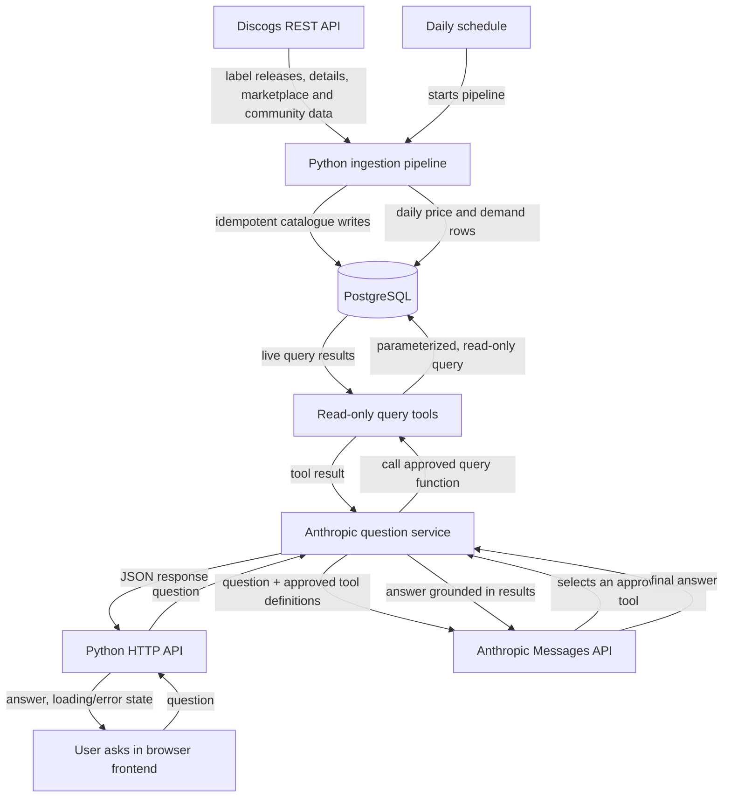

# Music Catalogue Market Trends

[](https://github.com/AntonisKol/music-catalogue-market-trends-wip/actions/workflows/tests.yml)

A step-by-step project for building a pipeline that collects vinyl release data from the Discogs REST API, stores catalogue and daily market snapshots in PostgreSQL, and lets people ask questions about the live dataset in natural language.

The language model does not connect directly to PostgreSQL or invent SQL to run. The application gives it a small set of approved, read-only data tools. The model chooses a tool for a user's question, the application runs a parameterized query, and the model explains the returned data.

**Stack:** Python, PostgreSQL, Docker, Discogs REST API, Anthropic API, and a browser frontend.

## How the app works



The browser sends questions to the Python API; the server calls the Anthropic API on the user's behalf and uses approved read-only tools to query PostgreSQL. PostgreSQL remains the source of truth. The pipeline updates it, and the web app reads it. API keys and database credentials stay on the server and are never sent to the browser.

## Project roadmap: one task at a time

The tasks below are ordered so each step builds on working code from the previous one. Start with **Task 1** and do not start a blocked task early. Every task has a corresponding issue on the [GitHub project board](https://github.com/users/AntonisKol/projects/3), where priority and blocker links are tracked.

| Step | Issue | Priority | Status | What you'll build |
| --- | --- | --- | --- | --- |
| 1 | [#5 Persist Discogs vinyl release data in PostgreSQL](https://github.com/AntonisKol/music-catalogue-market-trends-wip/issues/5) | P0 | Done | A Python/psycopg repository that maps Discogs records to the existing tables and writes them safely and repeatedly. |
| 2 | [#2 Test Discogs ingestion and PostgreSQL pipeline](https://github.com/AntonisKol/music-catalogue-market-trends-wip/issues/2) | P0 | Done | Automated tests for API handling and database mapping/upserts, using mocked HTTP and a test database. |
| 3 | [#3 Capture daily vinyl price and demand snapshots](https://github.com/AntonisKol/music-catalogue-market-trends-wip/issues/3) | P0 | Done | Fetch market supply/price and community demand, then store one snapshot per release per day. |
| 4 | [#6 Build a repeatable Discogs-to-PostgreSQL ingestion pipeline](https://github.com/AntonisKol/music-catalogue-market-trends-wip/issues/6) | P0 | Done | A Python command that connects label pagination, release detail fetching, catalogue writes, and snapshot writes. |
| 5 | [#10 Schedule and operate daily ingestion](https://github.com/AntonisKol/music-catalogue-market-trends-wip/issues/10) | P2 | Todo | Run the pipeline daily, avoid overlapping runs, and document logs, failures, and safe retries. |
| 6 | [#11 Add safe read-only query tools for the live dataset](https://github.com/AntonisKol/music-catalogue-market-trends-wip/issues/11) | P1 | Done | A restricted database role and a small set of parameterized query functions for release lookup and price/demand comparisons. |
| 7 | [#7 Add Anthropic-powered natural-language queries over live data](https://github.com/AntonisKol/music-catalogue-market-trends-wip/issues/7) | P1 | Todo | Use Anthropic tool use: the model selects an approved Python query tool, the app executes it, and the model explains the live results. |
| 8 | [#9 Test the Anthropic query service and guardrails](https://github.com/AntonisKol/music-catalogue-market-trends-wip/issues/9) | P1 | Todo; blocked by #7 | Test the assistant service, tool selection, read-only behavior, query limits, and grounded answers without live API calls. |
| 9 | [#8 Expose natural-language questions through a Python web API](https://github.com/AntonisKol/music-catalogue-market-trends-wip/issues/8) | P1 | Todo; blocked by #7 and #9 | Add a validated HTTP/JSON endpoint for the browser to call; keep Anthropic and database credentials server-side. |
| 10 | [#12 Build the natural-language question web frontend](https://github.com/AntonisKol/music-catalogue-market-trends-wip/issues/12) | P1 | Todo; blocked by #8 | Build the user-facing question form and answer view, including loading, validation, and error states. |
| 11 | [#13 Test web question frontend and accessibility](https://github.com/AntonisKol/music-catalogue-market-trends-wip/issues/13) | P1 | Todo; blocked by #12 | Test the browser experience, API integration, keyboard interaction, focus, and accessibility announcements. |

### What each task teaches

1. **Persist records — Python, psycopg, PostgreSQL.** Follow one Discogs response into the database. Separate API response mapping from SQL, respect foreign-key order, and use `INSERT ... ON CONFLICT` so rerunning ingestion updates records instead of duplicating them.
2. **Test ingestion — unittest/pytest, mocks, PostgreSQL.** Test the mapping and failure paths without making live Discogs requests. Use a disposable test database for SQL behavior; never point tests at valuable local data.
3. **Capture snapshots — Discogs REST API, Python, PostgreSQL.** Use the relevant release and marketplace/community endpoints, map only available fields, and use the schema's `(release_id, snapshot_date)` uniqueness to make a daily run repeatable.
4. **Build the pipeline command — Python CLI.** Compose existing small functions rather than putting the whole workflow in one function: list label releases, fetch details, write catalogue data, then write snapshots. Surface API and database errors instead of hiding them.
5. **Schedule daily ingestion — scheduler, Docker, logs.** Reuse the same ingestion command on a schedule. Make failures visible and retries safe; scheduling is separate from the pipeline so local development remains simple.
6. **Add safe query tools — PostgreSQL permissions, parameterized SQL.** Give the question feature a read-only database role. Implement narrowly scoped functions with parameters and bounded results; do not execute SQL text supplied by a user or generated by a model.
7. **Connect Anthropic — Anthropic Messages API, tool use.** Send the question and descriptions of the approved tools. When the model requests a tool, validate its input, call the matching Python function, return the result to the model, and produce a data-grounded answer. Keep the API key in an environment variable.
8. **Test the question service — Python tests, mocks.** Mock Anthropic responses and database tools. Confirm unsupported questions and failures are handled clearly, tool arguments are validated, results are bounded, and generated text cannot change database data.
9. **Expose the question service — Python HTTP API.** Accept a validated question and return a clear JSON response. Keep API keys on the server and return safe, useful error responses.
10. **Build the frontend — HTML, CSS, and JavaScript.** Create the browser form, example questions, answer display, and loading/error states. Use `fetch` to call the Python API; the browser never connects directly to PostgreSQL or Anthropic.
11. **Test the frontend — browser and accessibility checks.** Verify submission and response states against a mocked API, then test keyboard use, accessible labels, focus, and screen-reader status announcements.

## How to learn as you build

Work on one issue at a time, in roadmap order. For each task:

1. Read the issue and identify its prerequisite tasks.
2. Before changing code, trace the data flow and explain the relevant Python, SQL, and API concepts in your own words.
3. Make the smallest working change. Ask for a walkthrough of each file and decision rather than asking for the entire project to be generated at once.
4. Run the task's tests and a small manual check; inspect the database or output to confirm the behavior.
5. Review what happens on invalid input and API/database failure. Do not mark the issue Done until its acceptance criteria pass.
6. Summarize what you learned, then move the issue to Done and begin the next unblocked task.

An effective coding prompt is: *“Let's work only on roadmap Task 1. First explain the files and concepts we need, then make one small change at a time. Pause after each step so I can review it. Do not start another task.”*

## What's already implemented

- PostgreSQL schema for labels, artists, releases, release/artist relationships, and daily price and demand snapshots.
- Docker Compose configuration for PostgreSQL 16; the schema initializes on first database creation.
- Discogs client functions for fetching a release and paginating through a label's release summaries.
- Saving one release to PostgreSQL: its label, artists and the release itself, written in one transaction with repeatable upserts (`python -m ingestion.save_release <id>`).
- A daily price and demand snapshot per release: lowest price (always in EUR) and copies for sale, plus want, have and rating, one row per release per UTC day (`python -m ingestion.save_snapshot <id>`).
- Ingesting a whole label: every vinyl release on it and today's snapshot of each, with paced requests, retries for temporary Discogs errors, timestamped progress and a summary of any failures (`python -m ingestion.ingest_label <label_id>`).
- A read-only database login for the question feature, and five validated, capped query tools in `queries/tools.py`: `search_releases`, `rank_releases`, `release_history`, `market_changes` and `compare_labels` (see [Query the data read-only](#query-the-data-read-only)).
- Automated tests for the Discogs client, the mapping, saving releases and snapshots to PostgreSQL, the commands, the reader login and the query tools, run by GitHub Actions on every pull request (see [Run the tests](#run-the-tests)). The reasoning behind each decision is in [docs/decisions.md](docs/decisions.md), and diagrams of the whole system, the task map and the problems solved so far are in [docs/architecture.md](docs/architecture.md).

Scheduling, the natural-language question service, the web API and the frontend are roadmap work.

## Requirements

- Docker with Compose
- Python 3.10 or newer. The pinned libraries do not install on older versions, and macOS's built-in `python3` is 3.9: check with `python3 --version`, and if needed install a newer one (for example `brew install python@3.12`, then use `python3.12` below)
- A [Discogs personal access token](https://www.discogs.com/settings/developers)
- An [Anthropic API key](https://console.anthropic.com/) for the natural-language question feature

## Set up the current project

From the repository root, create a `.env` file. Compose and the Python client read these values:

```dotenv
DISCOGS_TOKEN=your_personal_access_token
DISCOGS_USER_AGENT=MusicCatalogueMarketTrends/0.1 +https://github.com/AntonisKol/music-catalogue-market-trends-wip
ANTHROPIC_API_KEY=your_anthropic_api_key
POSTGRES_HOST=localhost
POSTGRES_PORT=5432
POSTGRES_USER=catalogue
POSTGRES_PASSWORD=catalogue
POSTGRES_DB=catalogue
POSTGRES_READER_USER=catalogue_reader
POSTGRES_READER_PASSWORD=choose_a_different_password
```

`DISCOGS_USER_AGENT` must identify this app. Discogs rejects generic clients. Use your own token and password; these values are examples for local development, not production credentials. Do not commit `.env`.

Start PostgreSQL. On the first start, Docker applies `db/schema.sql` automatically:

```bash
docker compose up -d
docker compose exec db psql -U catalogue -d catalogue -c '\dt'
```

Create a Python environment and install dependencies:

```bash
python3 -m venv .venv
source .venv/bin/activate
pip install -r requirements.txt
```

Fetch one release using the current API client:

```bash
python - <<'PY'
from ingestion.discogs_client import get_release

release = get_release(249504)
print(release["title"], release.get("year"))
PY
```

To fetch a label's release summaries, replace `12345` with a Discogs label id:

```bash
python - <<'PY'
from ingestion.discogs_client import get_label_releases

summaries = get_label_releases(12345)
print(len(summaries), summaries[0]["id"], summaries[0]["title"])
PY
```

The label endpoint returns summaries, not the full release records needed by the database; the ingestion pipeline below fetches each release's details before writing it. Every Discogs request is paced at least 1.1 seconds apart, to stay under the authenticated limit of 60 a minute. A large catalogue can take a while.

Save one release, with its label and artists, to PostgreSQL:

```bash
python -m ingestion.save_release 249504
```

It prints the saved release, for example `Saved 249504: Rick Astley - Never Gonna Give You Up (1987) on RCA`. Running it again updates the same rows instead of adding duplicates. If Discogs or the database fails, it prints what went wrong, keeps nothing from the failed save, and exits with status 1.

Save today's price and demand snapshot of a release (the release itself is saved or updated first):

```bash
python -m ingestion.save_snapshot 249504
```

It prints, for example, `Snapshot of 249504 on 2026-11-01 (UTC): 124 for sale from 0.59 EUR; want 594, have 4159; rated 3.88 by 249`. Prices come from Discogs' marketplace statistics and are always requested in EUR. "Today" is the UTC date, and running it again on the same day replaces that day's values. A release with nothing for sale is stored with no price, and one nobody has rated with no average (shown as "not rated"), rather than as 0.

Ingest a whole label: every vinyl release on it, and today's snapshot of each:

```bash
python -m ingestion.ingest_label 800000
```

Progress is logged with timestamps, one line per release, for example `[1/11] 1832937 saved: 38 for sale from 2.99 EUR; want 39, have 328; rated 2.54 by 35`, and the run ends with a summary such as `Label 2 done: 27 listed, 23 saved, 4 not vinyl, 0 not on this label, 0 gone, 0 failed`. It takes about 2 seconds per vinyl release, so a label with 500 releases takes roughly 15 minutes.

- **Vinyl only.** Releases whose list entry is clearly CD, file, cassette or video are skipped without a request. Every other release is kept only if its details include the format "Vinyl". Releases listed twice are ingested once.
- **Issued on the label, not just credited.** A label's Discogs list also holds releases where it only appears in a credit, such as a studio under "Recorded At". Those are skipped as "not on this label". A co-release is still stored under its first label only.
- **Failures.** Rate limits (429), Discogs server errors and dropped connections are retried after 5, 15 and 60 seconds. Anything still failing, malformed data included, is logged for that release, and the run carries on with the rest. At the end every failed release is listed, and the command exits with status 1. If the database connection is lost, the run stops at once.
- **Gone releases.** A release still on the label's list that Discogs no longer has (404) is logged as a warning and listed as gone. It does not fail the run.
- **One run at a time.** A second run refuses to start while another one is in progress, since together they would exceed Discogs' rate limit. It exits with status 1.
- **Safe to rerun.** Each release is committed as soon as it is saved, so an interrupted run keeps what it finished. Running it again the same day updates the same rows.

## Query the data read-only

The question feature never uses the login above. It has its own PostgreSQL login that may only read. Create it once per database, with the reader settings from `.env`:

```bash
python -m ingestion.create_reader_role
```

Running it again updates the password. The database itself refuses every write from this login, also on tables added later, opens its sessions read-only, and stops any query after 5 seconds. It also takes the right to create temporary tables away from every login except the database's owner. The web side (`queries/`) only ever needs `POSTGRES_HOST`, `POSTGRES_PORT`, `POSTGRES_DB` and the two reader settings, never the Discogs token or the writing login's password.

The five query tools are the only way the question feature reads data:

```bash
python - <<'PY'
from queries.database import connect_reader
from queries.tools import run_tool

with connect_reader() as conn:
    print(run_tool(conn, "rank_releases", {"sort_by": "most_wanted", "label": "planet e", "limit": 5}))
PY
```

| Tool | Answers questions like |
| --- | --- |
| `search_releases` | "Which Carl Craig records from the 90s are in the catalogue?" |
| `rank_releases` | "Cheapest / most wanted / best rated / scarcest records on this label?" |
| `release_history` | "How has this record's price moved over the last 90 days?" |
| `market_changes` | "Which records got more expensive, or sold out, this month?" |
| `compare_labels` | "How do these labels compare on prices and demand?" |

Arguments are checked before any query runs: wrong types, out-of-range numbers, unknown sort options and unexpected fields are refused with a clear reason, and so is a query stopped by the 5-second limit. Text filters match any part of a name, ignoring case. Every result says how many rows matched in total: the list tools return at most 50 rows (25 by default), `release_history` one row per day for up to 90 days, and `compare_labels` up to 10 labels. Only vinyl releases are ever returned, even if a CD was saved with `save_release`. Prices are each release's cheapest copy on sale in any condition, without shipping, in EUR (converted by Discogs), from its latest snapshot.

## Reset the local database

Schema changes apply only when the data volume is created. To reapply `db/schema.sql` from scratch, this deletes the local database volume and its data:

```bash
docker compose down -v
docker compose up -d
```

## Run the tests

```bash
python -m pytest
```

The tests need no `.env` and never use your token or your database: `tests/conftest.py` sets fake settings, and Discogs is faked with the [`responses`](https://github.com/getsentry/responses) library.

The database tests start their own throwaway PostgreSQL 16 container with [Testcontainers](https://testcontainers-python.readthedocs.io/), load `db/schema.sql`, and remove the container when the run ends. Docker must be running for them. Without Docker they are skipped with a reason, except in CI (`CI=true`), where they fail so a run can't pass without them. Your local database on port 5432 is never touched.

### Continuous integration

[GitHub Actions](.github/workflows/tests.yml) runs every test on each pull request and each push to `main`, on Python 3.10 and 3.13 (the oldest and newest supported). The database tests start their own PostgreSQL there too, and `CI=true` makes them fail rather than skip if Docker is missing. A pull request can only be merged into `main` when both runs are green. The actions the workflow uses are pinned to exact commits, and [Dependabot](.github/dependabot.yml) proposes their updates as pull requests.
