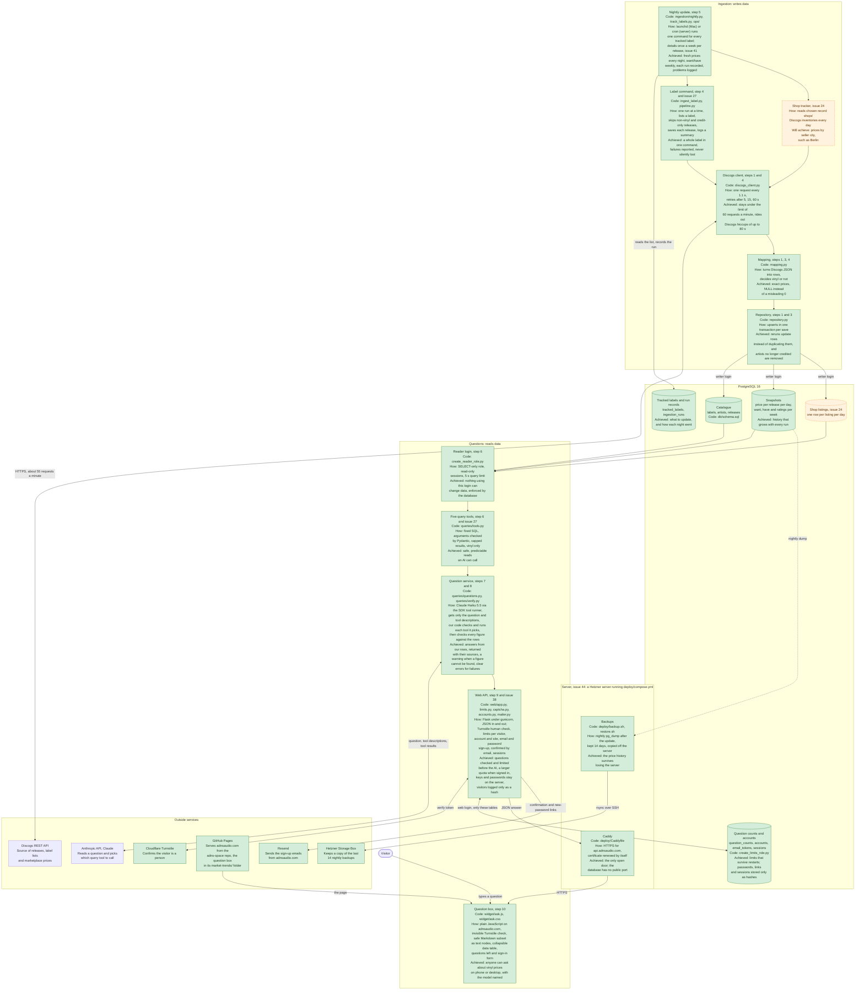
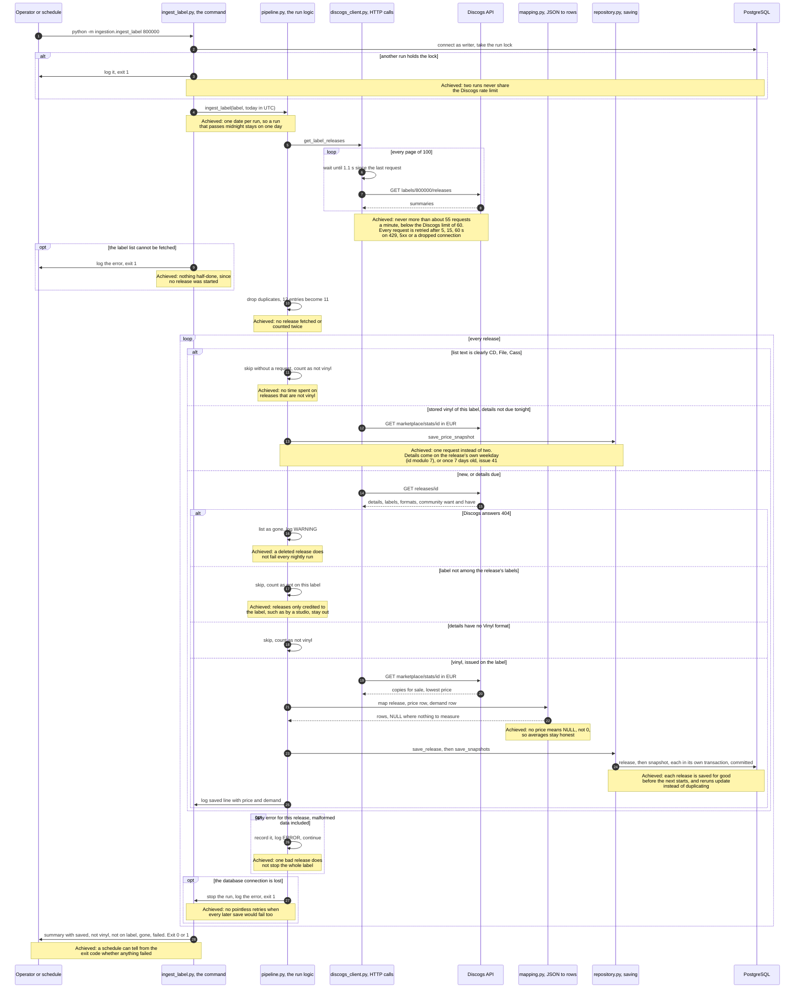
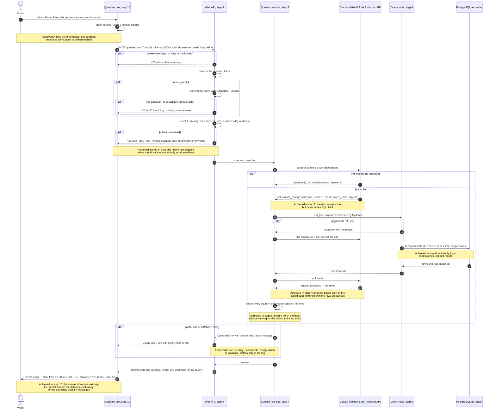
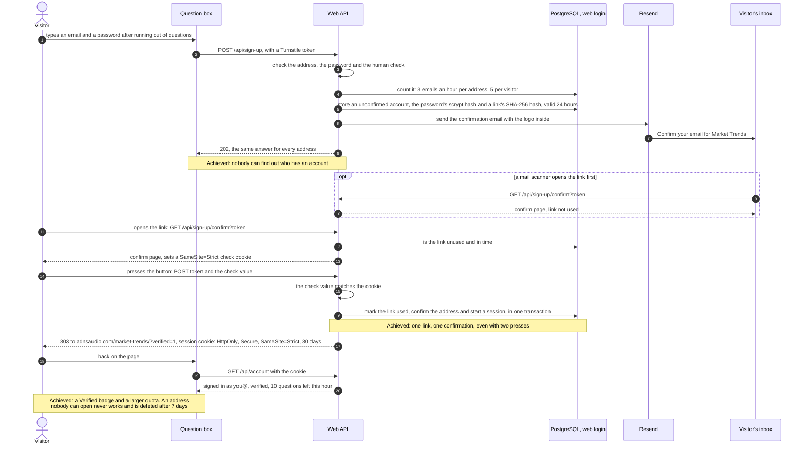

# Architecture and task map

How the project fits together, what each part is made of, and how it was built step by step, including the problems met on the way and how they were solved. The reasoning behind each individual decision is in [decisions.md](decisions.md).

- **Everyone:** the diagrams, the *In one sentence* lines and the problem log read without coding knowledge.
- **Developers:** every box names its code file, and the components table goes into detail.

*Last updated: 7 November 2026, after sign-up with email confirmation was added. 424 automated tests, run by GitHub Actions on every pull request, plus a before-release test with the real Claude and a browser check of the question box.*

**How to read the diagrams.** Each box gives the part's name, its **code** (file), **how** it works, and its outcome:

- **Achieved:** the part is built, tested and merged. Green boxes.
- **Will achieve:** the part is planned. Grey boxes with dashed borders.
- Orange boxes are supporting work alongside the main steps that is still open: seller locations and documentation. Supporting work that is finished, such as CI, is green.

Steps are numbered as in the README roadmap (step 1 to step 11). Each step is one GitHub issue, whose number is given too.

---

## 1. The system at a glance

In one sentence: every night a Python job copies the vinyl releases of chosen labels, with that day's prices and demand, from Discogs into PostgreSQL. A read-only set of query tools then lets an AI answer people's questions on a web page from that data.

Two separate logins protect the data. The **writer** (used only by ingestion) can change tables. The **reader** (used by everything a visitor can reach) can only read, and the database itself enforces that. The Discogs token, the Anthropic key and both passwords stay on the server and never reach the browser.

On the server (issue 44) the database, the API and Caddy each run in their own container. Only Caddy is reachable from the internet, on ports 80 and 443. The page itself is plain files on GitHub Pages, like the rest of adnsaudio.com.

---

## 2. Task map, from step 1 to the web page

In one sentence: steps are built in dependency order, and each arrow means "needs this first".

```mermaid
flowchart TD
    S0["Starting point: schema and Docker<br/>Code: db/schema.sql, docker-compose.yml<br/>How: SQL tables, PostgreSQL 16 in a container<br/>Achieved: the same database on any machine"]
    S1["Step 1, issue 5: Save releases<br/>Code: repository.py, mapping.py, save_release.py<br/>How: psycopg upserts in one transaction<br/>Achieved: a release with its label and<br/>artists, saved again without duplicates"]
    S2["Step 2, issue 2: Tests and test database<br/>Code: tests/, conftest.py<br/>How: pytest, Discogs faked with responses,<br/>a throwaway PostgreSQL via Testcontainers<br/>Achieved: every change checked<br/>without touching real data"]
    S3["Step 3, issue 3: Daily snapshots<br/>Code: save_snapshot.py, repository.py<br/>How: marketplace stats in EUR plus<br/>want, have and rating, one row per day<br/>Achieved: price and demand history"]
    S4["Step 4, issue 6: Ingest a whole label<br/>Code: pipeline.py, ingest_label.py<br/>How: dedupe, vinyl filter, pacing,<br/>retries, commit per release, logging<br/>Achieved: a whole label in one command,<br/>failures listed, never silently lost"]
    S5["Step 5, issue 10: Nightly update<br/>Code: nightly.py, track_labels.py, runs.py<br/>How: tracked_labels table, launchd or cron,<br/>run lock, run records, rotating log<br/>Achieved: data refreshed every night, missed<br/>nights flagged, safe reruns"]
    F41["Issue 41: Prices nightly, details weekly<br/>Code: pipeline.py, repository.py, tools.py<br/>How: one weekday per release from its id,<br/>details over 7 days old fetched anyway<br/>Achieved: about half the requests a night,<br/>all tracked labels in one night"]
    S6["Step 6, issue 11: Read-only query tools<br/>Code: queries/, create_reader_role.py<br/>How: SELECT-only role, 5 fixed tools,<br/>Pydantic checks, capped results<br/>Achieved: safe reads for the AI"]
    S7["Step 7, issue 7: AI question service<br/>Code: queries/questions.py<br/>How: Claude Haiku 5.5, SDK tool runner over<br/>the 5 tools, prompt caching, no round cap<br/>Achieved: questions answered from the<br/>stored data with their sources,<br/>the AI never writes SQL"]
    S8["Step 8, issue 9: Test the AI service<br/>Code: tests/test_questions.py, test_verify.py,<br/>test_live_answers.py<br/>How: faked AI for guardrails, a free figure check<br/>on every answer, a live test with an AI judge<br/>Achieved: wrong figures flagged to visitors,<br/>tool choice, limits, errors and read-only<br/>access proven, real answers checked before releases"]
    S9["Step 9, issue 8: Web API<br/>Code: web/, create_limits_role.py<br/>How: Flask, Cloudflare Turnstile, limits per<br/>visitor and site in a PostgreSQL table<br/>Achieved: one endpoint for the page, bots and<br/>heavy use stopped before the AI, JSON errors,<br/>no secrets or usage sent to the browser"]
    S10["Step 10, issue 12: Question box<br/>Code: widget/<br/>How: plain HTML, CSS and JavaScript,<br/>no build step, the site's own colours and fonts<br/>Achieved: example questions, loading, answer and<br/>error states, no double submits, model named,<br/>data one click away, nothing in an answer runs"]
    S11["Step 11, issue 13: Test the web page<br/>How: browser tests against a faked API,<br/>plus one end-to-end check<br/>Will achieve: keyboard, labels, focus and<br/>screen-reader announcements verified"]
    F19["Issue 19: CI runs all tests<br/>Code: .github/workflows/tests.yml<br/>How: GitHub Actions on Python 3.10 and 3.13,<br/>Testcontainers PostgreSQL, CI=true,<br/>actions pinned to exact commits<br/>Achieved: no pull request merges into<br/>main unless all tests pass"]
    F24["Issue 24: Tracked techno shops<br/>How: chosen shops' Discogs inventories,<br/>city recorded by us, a sixth query tool<br/>Will achieve: questions by seller city,<br/>such as records sold from Berlin"]
    F27["Issue 27: Fixes from a code review<br/>Code: pipeline.py, ingest_label.py, tools.py<br/>How: one run at a time, credit-only and<br/>deleted releases handled, vinyl-only answers<br/>Achieved: the code does what the docs promise"]
    F38["Issues 38, 49: Sign-up and quotas<br/>Code: web/accounts.py, mailer.py, widget/<br/>How: email and password, a confirmation link by<br/>Resend, a sessions table, counts per account<br/>Achieved: 3 questions a day to try, 10 an hour<br/>and 50 a day when verified, fake addresses never<br/>get a working account, accounts deletable"]
    F44["Issue 44: Hosting<br/>Code: Dockerfile, deploy/<br/>How: a Hetzner server with Docker Compose,<br/>Caddy for HTTPS, cron for the nightly update,<br/>backups to a Storage Box, one deploy command,<br/>the box on the site's own page<br/>Achieved: everything ready to run online;<br/>live once the server and accounts exist"]
    F18["Issues 18 and 25: Documentation<br/>Code: README, decisions.md, this page<br/>Achieved: decisions and architecture<br/>written down, updated with every step"]

    S0 --> S1
    S1 --> S2
    S1 --> S3
    S2 --> S4
    S3 --> S4
    S4 --> S5
    S5 --> F41
    S4 --> S6
    S6 --> S7
    S7 --> S8
    S7 --> S9
    S8 --> S9
    S9 --> S10
    S10 --> S11
    S9 --> F38
    S10 --> F38
    S5 --> F44
    F38 --> F44
    S2 --> F19
    S4 --> F24
    S6 --> F24
    S4 --> F27
    S6 --> F27

    classDef built fill:#d4edda,stroke:#2e7d32,color:#1b3d1f
    classDef planned fill:#eeeeee,stroke:#9e9e9e,color:#555555,stroke-dasharray: 4 3
    classDef support fill:#fff3e0,stroke:#ef6c00,color:#5d3200
    class S0,S1,S2,S3,S4,S5,S6,S7,S8,S9,S10,F27,F19,F41,F38,F44 built
    class S11 planned
    class F24,F18 support
```

| Step | Issue | Status | What it gives | Main tech |
| --- | --- | --- | --- | --- |
| Start | – | Built | The tables and a local PostgreSQL | SQL, Docker Compose |
| 1 | [5](https://github.com/AntonisKol/music-catalogue-market-trends-wip/issues/5) Save releases | Built | One release with label and artists, saved repeatably | Python, psycopg, upserts |
| 2 | [2](https://github.com/AntonisKol/music-catalogue-market-trends-wip/issues/2) Tests | Built | Fake Discogs, a throwaway test database | pytest, responses, Testcontainers |
| 3 | [3](https://github.com/AntonisKol/music-catalogue-market-trends-wip/issues/3) Snapshots | Built | One price and demand row per release per day | Discogs marketplace API |
| 4 | [6](https://github.com/AntonisKol/music-catalogue-market-trends-wip/issues/6) Pipeline | Built | A whole label in one command | logging, pacing, retries |
| 5 | [10](https://github.com/AntonisKol/music-catalogue-market-trends-wip/issues/10) Nightly update | Built | Every tracked label refreshed each night, every run recorded, problems logged | launchd, cron, PostgreSQL |
| 6 | [11](https://github.com/AntonisKol/music-catalogue-market-trends-wip/issues/11) Query tools | Built | Safe, capped reads for the AI | PostgreSQL roles, Pydantic |
| 7 | [7](https://github.com/AntonisKol/music-catalogue-market-trends-wip/issues/7) AI service | Built | Questions answered from the data, with their sources | Anthropic Messages API, tool runner, Claude Haiku 5.5 |
| 8 | [9](https://github.com/AntonisKol/music-catalogue-market-trends-wip/issues/9) Test AI | Built | Guardrails proven with a faked AI; figures checked on every answer; a live before-release test with an AI judge | pytest, httpx MockTransport, Claude Opus 5.5 as judge |
| 9 | [8](https://github.com/AntonisKol/music-catalogue-market-trends-wip/issues/8) Web API | Built | One endpoint for the page; a human check and limits per visitor and for the site before any AI call | Flask, gunicorn, Cloudflare Turnstile, PostgreSQL |
| 10 | [12](https://github.com/AntonisKol/music-catalogue-market-trends-wip/issues/12) Question box | Built | The question box for adnsaudio.com, checked in a real browser | HTML, CSS, JavaScript, Cloudflare Turnstile |
| 11 | [13](https://github.com/AntonisKol/music-catalogue-market-trends-wip/issues/13) Test page | Planned | Keyboard, focus and screen-reader checks | browser tests |
| – | [27](https://github.com/AntonisKol/music-catalogue-market-trends-wip/issues/27) Review fixes | Built | Malformed data, deleted and credit-only releases handled; one run at a time; vinyl-only answers | Python, PostgreSQL advisory lock |
| – | [38](https://github.com/AntonisKol/music-catalogue-market-trends-wip/issues/38), [49](https://github.com/AntonisKol/music-catalogue-market-trends-wip/issues/49) Sign-up | Built | Anyone can sign up with an email and a password, confirm by email and return to the page with a Verified badge; quotas per account; account deletion | Flask, PostgreSQL, Resend |
| – | [41](https://github.com/AntonisKol/music-catalogue-market-trends-wip/issues/41) Weekly details | Built | Prices every night, want/have/ratings once a week per release, spread over the week; about half the requests a night | Python, PostgreSQL |
| – | [44](https://github.com/AntonisKol/music-catalogue-market-trends-wip/issues/44) Hosting | Built, not yet live | The API, database and nightly update on a server, HTTPS by Caddy, nightly backups off the server, one deploy command, the page on adnsaudio.com | Docker Compose, Caddy, cron, rsync, GitHub Pages |
| – | [19](https://github.com/AntonisKol/music-catalogue-market-trends-wip/issues/19) CI | Built | Every pull request runs all tests, including the database ones, and must pass to merge | GitHub Actions, Dependabot |
| – | [48](https://github.com/AntonisKol/music-catalogue-market-trends-wip/issues/48) Label list and private logs | Built | Visitors see which labels are covered, live from the database; abuse can be spotted from logs that hold no addresses | Flask, PostgreSQL, logging |
| – | [24](https://github.com/AntonisKol/music-catalogue-market-trends-wip/issues/24) Tracked shops | Planned | Questions by seller city, e.g. Berlin | Discogs inventory API |
| – | [18](https://github.com/AntonisKol/music-catalogue-market-trends-wip/issues/18), [25](https://github.com/AntonisKol/music-catalogue-market-trends-wip/issues/25) Documentation | Ongoing | README, decisions and this page kept current | Markdown, Mermaid |

---

## 3. One ingestion run, step by step

In one sentence: the command makes sure no other run is going, lists a label's releases and skips what is clearly not vinyl. A release already stored whose details are recent gets only tonight's price. Otherwise it fetches the details, checks the release was issued on the label and is vinyl, fetches the prices, saves them, and commits before moving on.

Smaller commands for one release at a time: `save_release` saves a release with its label and artists, and `save_snapshot` adds that day's price and demand. Both use the same client, mapping and repository.

---

## 4. A visitor's question, step by step

In one sentence: the AI never touches the database. It can only ask for one of five fixed tools, whose answers come back capped and are turned into a plain-language reply on the web page.

The five query tools, built in step 6, are all the AI can use:

| Tool | Answers questions like | Limits |
| --- | --- | --- |
| `search_releases` | "Which Underground Resistance records from the 90s are in the catalogue?" | Filters: title, label, artist, genre, style, country, years |
| `rank_releases` | "Cheapest Tresor records right now", "most wanted Detroit techno" | 7 fixed rankings: lowest or highest price, most wanted, most owned, best rated, fewest for sale, most wanted per owner |
| `release_history` | "How has the price of this record moved?" | Day by day, up to 90 days |
| `market_changes` | "Which records got more expensive this month?" | Lowest price, copies for sale, want or have; rises or falls; up to 365 days |
| `compare_labels` | "Compare Tresor and Axis" | Up to 5 labels: releases, copies for sale, average and median price, want, have, rating |

The list tools return at most 50 rows (25 unless asked for more), plus the total number that matched. `release_history` returns one row per day, so at most 90, and `compare_labels` at most 10. Every tool returns vinyl only, and a query stopped by the 5-second limit comes back as a readable reason. Each tool description tells the AI what the price means: the cheapest copy on sale in any condition, without shipping, in EUR converted by Discogs.

### Signing up, issues 38 and 49

In one sentence: a visitor signs up with an email address and a password, and the account only works once they press the button behind a link sent to that address.

Later visits use `POST /api/sign-in` with the password. A forgotten password takes the same route as above: a link by email, a page, then back to the box signed in.

---

## 5. Components

| Part | Code | Tech | What it does | Safeguards |
| --- | --- | --- | --- | --- |
| Schema | [`db/schema.sql`](../db/schema.sql) | PostgreSQL 16 | Tables: labels, artists, releases, release_artists, price_snapshots, demand_snapshots | One snapshot per release per day (unique key) |
| Local database | [`docker-compose.yml`](../docker-compose.yml) | Docker Compose | Runs PostgreSQL on port 5432 and loads the schema on first start | Data kept in a named volume |
| Settings | [`ingestion/config.py`](../ingestion/config.py), [`queries/config.py`](../queries/config.py) | python-dotenv | Read `.env`; stop at once if a setting is missing | The web side never sees the Discogs token or the writer's password |
| Discogs client | [`ingestion/discogs_client.py`](../ingestion/discogs_client.py) | requests | Fetches releases, label pages and marketplace stats | 1.1 s between requests; retries 429, 5xx and dropped connections after 5, 15, 60 s; 30 s timeout |
| Mapping | [`ingestion/mapping.py`](../ingestion/mapping.py) | pure Python | Turns Discogs JSON into table rows; decides vinyl or not | No price stored as NULL, not 0; no ratings stored as NULL, not 0.0; exact decimal prices |
| Repository | [`ingestion/repository.py`](../ingestion/repository.py) | psycopg 3 | Saves releases and snapshots | Upserts, so a rerun updates instead of duplicating; one transaction per save; artists no longer credited are unlinked |
| Single-release commands | [`save_release.py`](../ingestion/save_release.py), [`save_snapshot.py`](../ingestion/save_snapshot.py) | Python CLI | Save one release, or one release plus today's snapshot | Clear messages and exit codes |
| Label pipeline | [`ingestion/pipeline.py`](../ingestion/pipeline.py), [`ingest_label.py`](../ingestion/ingest_label.py) | Python CLI, logging | Ingests every vinyl release of a label | One run at a time (advisory lock); duplicates dropped; credit-only releases skipped; deleted releases listed as gone; failures, malformed data included, listed and exit 1; commit per release; stops if the label list cannot be fetched or the database connection is lost |
| Reader login | [`ingestion/create_reader_role.py`](../ingestion/create_reader_role.py) | PostgreSQL roles | Creates the SELECT-only login | Read-only sessions and a 5 s limit set on the role; future tables readable, never writable; no temporary tables |
| Query tools | [`queries/tools.py`](../queries/tools.py), [`queries/database.py`](../queries/database.py) | Pydantic, psycopg | search_releases, rank_releases, release_history, market_changes, compare_labels | Validated arguments; fixed SQL; capped results with the total; wildcards escaped; vinyl only; timeouts reported as a readable reason |
| Tests | [`tests/`](../tests) | pytest, responses, Testcontainers | 390 tests: fake Discogs, a fake Anthropic API, a throwaway PostgreSQL, a fake clock; a `--live` before-release test with the real Claude and an AI judge | Database tests skip without Docker on a laptop, fail in CI; live tests never run without `--live` |
| Question service | [`queries/questions.py`](../queries/questions.py) | Anthropic SDK tool runner, Claude Haiku 5.5 | Sends the question and tool descriptions to Claude, runs the tools it asks for, returns the answer with its sources | Claude never sees SQL or the database; refused arguments go back as errors; a database failure stops the run; every error becomes a visitor-safe `QuestionError`; instructions and tools cached |
| Web API | [`web/app.py`](../web/app.py), [`limits.py`](../web/limits.py), [`captcha.py`](../web/captcha.py), [`create_limits_role.py`](../ingestion/create_limits_role.py) | Flask, gunicorn, Cloudflare Turnstile | `POST /api/questions`: checks the request, the human check and the limits, then asks the question service | Fails closed; limits counted in one transaction by a login that can only touch its four tables; visitors stored as a keyed hash, deleted after two days; forwarded addresses trusted only behind a configured proxy; usage never sent; 8 KB body limit; CORS only for listed origins; the access log holds a keyed hash, never the address, and visitors can't fake a line in it; logs limited in size |
| Sign-up | [`web/accounts.py`](../web/accounts.py), [`mailer.py`](../web/mailer.py) | PostgreSQL, Resend | Sign-up, confirmation and new-password links, password sign-in, sessions, sign-out and account deletion | Passwords stored as salted scrypt hashes; tokens are 32 random bytes, stored only as hashes; links work once; opening a link uses nothing; unconfirmed accounts can't sign in and are deleted after 7 days; forms checked against a `SameSite=Strict` cookie; session cookie `HttpOnly`, `Secure`, `SameSite=Strict`; the same answer for known and unknown addresses; tries and emails limited per address and visitor |
| Question box | [`widget/ask.js`](../widget/ask.js), [`ask.css`](../widget/ask.css), [`index.html`](../widget/index.html) | HTML, CSS, JavaScript, Cloudflare Turnstile | The list of tracked labels, the form, example questions, states, answer, warning, model and data table | Answers drawn from text nodes only; no double submits; token reset after each question; no secrets in the page; 90-second request timeout; the box still works if the label list can't load |
| Nightly update | [`ingestion/nightly.py`](../ingestion/nightly.py), [`track_labels.py`](../ingestion/track_labels.py), [`runs.py`](../ingestion/runs.py), [`ops/`](../ops) | launchd, cron | Updates every active tracked label each night (prices nightly, details weekly per release) and records each run and label | Shares the ingestion lock; interrupted runs marked failed; missed nights flagged; one label's failure doesn't stop the rest; rotating log |
| Schema command | [`ingestion/apply_schema.py`](../ingestion/apply_schema.py) | PostgreSQL | Adds tables introduced since a database was created | Every statement is `CREATE TABLE IF NOT EXISTS`; existing data untouched |
| Server setup | [`Dockerfile`](../Dockerfile), [`deploy/compose.yml`](../deploy/compose.yml), [`Caddyfile`](../deploy/Caddyfile), [`setup-server.sh`](../deploy/setup-server.sh), [`crontab`](../deploy/crontab), [`nightly.sh`](../deploy/nightly.sh) | Docker Compose, Caddy, cron, Ubuntu 24.04 | Runs the database, the API under gunicorn and Caddy; cron starts the nightly update at 03:00 UTC, then the backup | Only Caddy publishes ports; the database container gets only its own settings; `.env` never in the image; containers run as an ordinary user; firewall open for SSH, 80 and 443 only; SSH by key only, no root login; automatic security updates; tests check these |
| Backups | [`deploy/backup.sh`](../deploy/backup.sh), [`restore.sh`](../deploy/restore.sh) | pg_dump, rsync over SSH | A dump after every nightly update, kept 14 days on the server and on a Storage Box; restoring also sets up the logins again | A dump is checked before it is kept; a half-written dump is never kept; a failed backup is reported in `logs/cron.log`, and nothing is copied; half-written dumps left by a failed run are deleted by the next one; restoring asks for "yes" and runs in one transaction |
| Deploy | [`deploy/deploy.sh`](../deploy/deploy.sh) | SSH, git, GitHub Pages | Updates the server from `main`, adds new tables, checks the API answers, then copies the question box into the website repo | Pulls only fast-forward; only `ask.js` and `ask.css` are copied, so no secret can reach the website; a newer website commit is rebased onto, never overwritten |
| CI | [`.github/workflows/tests.yml`](../.github/workflows/tests.yml), [`dependabot.yml`](../.github/dependabot.yml) | GitHub Actions, Dependabot | Runs every test on Python 3.10 and 3.13 for each pull request and push to main | Required to pass before merging; read-only token; actions pinned to exact commits; runs stop after 15 minutes |

---

## 6. How problems are usually approached

The same routine has been used on every task:

1. **Check the facts at the source.** Before deciding, look at what the real system returns: call the live API, read the code, look at the database. Several decisions changed because of this. For example, the rating endpoint turned out to have no want and have numbers.
2. **Separate the environment from the code.** When something fails, first find out whether the cause is our code, the machine (Docker, disk, settings) or the outside service.
3. **Lay out the options with their trade-offs.** Name two or three ways, what each costs, and what risk each leaves open. Pick one deliberately and record why (see [decisions.md](decisions.md)).
4. **Make the smallest change that solves it,** in the place where the problem belongs.
5. **Prove it with tests,** including the failure cases. Since issue 19, CI runs them on every pull request.
6. **Plant bugs on purpose.** Break the code in specific ways and check that a test fails each time. Add a test whenever a planted bug survives.
7. **Run it for real.** Do a live run against Discogs and a throwaway database before handing over.
8. **Write it down.** Update the README, decisions.md and this page. Raise anything outside the task's scope as its own ticket instead of fixing it on the side.

---

## 7. Problem log: what went wrong and what we did

| Issue | Problem | Where it came from | What we did |
| --- | --- | --- | --- |
| 2 | Tests could not start on a fresh copy: the app stops when a setting is missing | Strict settings, which are deliberate | Tests set obviously fake settings themselves (`tests/conftest.py`); the app stayed strict |
| 2 | Docker could not start any container ("input/output error") | The Docker virtual machine (Colima) had disk errors and went read-only | Restarted Colima and recreated the local database container; no data was lost |
| 2 | Testcontainers failed on this Mac | Its clean-up helper looks for the Docker socket at a path that does not exist inside Colima | Pointed it at the socket inside the virtual machine (`TESTCONTAINERS_DOCKER_SOCKET_OVERRIDE`) |
| 2 | A green test run could hide skipped database tests | Without Docker the database tests skip | Skip on a laptop, fail when `CI=true`; CI itself is issue 19 |
| 3 | The Discogs documentation page refused automated reading | Discogs blocks scripted page requests | Called the live API with the project's own client and read the real answers |
| 3 | The release endpoint's price had no currency and ignored currency requests | How Discogs builds that response | Took prices from the marketplace stats endpoint, always in EUR |
| 3 | "No ratings" arrived as an average of 0.0 | Discogs' format | Stored as NULL (not rated), so averages are not dragged down |
| 3 | A bug-planting script reverted uncommitted work | Restoring files with git before committing | Re-applied the changes; since then work is committed before bugs are planted |
| 6 | A label list repeated releases (597 entries, 511 releases) | Discogs lists some releases twice | De-duplicated before fetching |
| 6 | Format text in label lists is loose and abbreviated | Discogs summary format | Skip only clear non-vinyl; let each release's details decide the rest |
| 6 | Saves were only committed at the end of a run | A read left a database transaction open, turning later saves into savepoints | Closed each read in its own transaction; a test checks releases are visible mid-run |
| 6 | Risk of hitting Discogs' rate limit | About 2 requests per release, 60 a minute allowed | Every request paced 1.1 s apart, temporary errors retried |
| 11 | A read-only session alone can be switched off | PostgreSQL session settings belong to the session | A separate SELECT-only login, with read-only sessions as a second lock |
| 11 | `%` and `_` typed by a user act as wildcards | SQL LIKE syntax | Escaped before matching; tests check they match literally |
| 11 | The live check showed releases filed under other labels | Discogs' label list includes releases where the label is only credited ("Recorded At"), and only the first label is stored | Credit-only releases skipped since issue 27; a co-release is still stored under its first label only |
| 27 | An artist without a name stopped a whole label run with no summary | The pipeline only expected Discogs, mapping and database errors | Malformed data is now recorded as a failed release; a test with a wrong data type found one more error type to add |
| 27 | A CD saved with `save_release` appeared in "vinyl" answers | Only the label pipeline checks for vinyl | Every query tool applies one shared vinyl condition |
| 27 | One deleted release would have failed every nightly run | Discogs keeps some deleted releases on label lists | A 404 is listed as gone, not as a failure |
| 27 | A studio's label list filled the catalogue with other labels' records | Label lists include releases where the label is only credited | Releases are kept only if their own labels include the one being ingested |
| 27 | Two runs at once would exceed the rate limit | Pacing works within one run only | A database advisory lock lets one run at a time |
| 27 | The live run's user agent could not be loaded by the shell | It contains a space and is not quoted in `.env` | Read with python-dotenv, as the app does, without displaying it |
| 19 | A check that has never failed proves nothing | A green run can also mean nothing was tested | Two throwaway pull requests: a planted bug gave 2 failures, and an unreachable Docker gave 116 errors instead of skips; both closed afterwards |
| 19 | Version tags of GitHub actions can be moved to other code | In March 2025 the tags of the `tj-actions/changed-files` action were moved to code that printed secrets into logs | Actions pinned to exact commits, updated through Dependabot pull requests |
| 7 | A database failure inside a tool would have reached Claude as text, followed by another request | The SDK's tool runner turns every tool exception into a message for the model | The service runs each round's tools itself and stops at once on a database failure; a planted bug proves it |
| 7 | The `responses` library could not fake the Anthropic API | The Anthropic SDK uses `httpx`, not `requests` | Faked with httpx's own `MockTransport`, so the real SDK and its runner still run in the tests |
| 7 | Answers came back with Markdown tables | The model formats its answers by default | Noted for the web page (step 10): render Markdown safely or ask for plain text |
| 9 | Tool schema bounds (25, 100, 1900, 2100) let invented prices pass the figure check | The first version allowed every number in the tool definitions | Only the instructions and plain tool descriptions count; schema bounds are left out |
| 9 | A live answer said "the data has no October prices" although it did, and the test passed | A 30-day lookup stopped one day short of the October snapshot; the check matched "10 copies" as €10; the judge accepted a claim of absence | Tool descriptions and instructions now ask for whole periods; prices checked as prices; the judge checks claims of absence; the second run answered correctly |
| 9 | A planted bug (list markers counted as figures) survived | The test's markers 1 and 2 happen to appear in the test data | Added markers 8 and 9, which appear nowhere; the bug is now caught |
| 8 | Two planted bugs survived | They changed nothing in the code's behaviour (a condition that was always true anyway, a proxy setting of zero), so they proved nothing | Replaced by bugs that really change what the code does; both were then caught |
| 12 | The browser check could not open the demo page | `localhost` resolved to IPv6 while the test server listened on IPv4 | The demo uses `127.0.0.1` for the page and the API |
| 12 | The faked API refused the page's request | The page and the API are on different origins, so the browser first asks permission (CORS), as on the real site | The fake answers that request with CORS headers, the same way the real API does |
| 12 | Trying the demo on a Mac showed "Could not reach the question service" | macOS uses port 5000, Flask's default, for AirPlay Receiver, which answered instead of the API | The demo and README use port 5050 |
| 38 | After using up their questions, visitors were told to "try again later" when they could not ask again until the next day | The hour was checked before the day, and with 3 an hour and 3 a day both ran out together | The day is checked first, so the longer wait is reported; a test covers it |
| 38 | A planted bug (signed-in questions counted against the visitor's address) survived | The tests checked the account's limit but not which count it was taken from | A test checks that the address's count stays untouched; the bug is now caught |
| 41 | The first import of 56 labels needed about 17 hours, and every later night as long | Two Discogs requests per release a night, at about 55 a minute | Details fetched once a week per release, spread over the week; prices every night |
| 10 | A planted bug (stop after the first failing label) survived | Labels run in name order, and the test's failing label happened to sort last | The failing label now sorts first; the bug is caught |
| 10 | Existing databases would not get the new tables | Docker applies `db/schema.sql` only when a database is first created | Every statement became `CREATE TABLE IF NOT EXISTS`, and `ingestion.apply_schema` applies it to an existing database |
| Setup | Commands could not start on a new machine | `.env` lacked most settings, and an appended line was glued onto the previous one | Added the settings and split the glued line, without displaying any values |
| 44 | The test copy's files could not be mounted into the containers | Colima shares only the home folder with its virtual machine, not the temporary folder | Ran the test copy from a folder in the home folder; the server has no such limit |
| 44 | The setup script stopped on a clean Ubuntu 24.04: "UID 1000 is not unique" | The image already has a user with that id, the one the containers run as | The deploy user takes any free id, and the logs folder is shared by both through its group |
| 44 | A deploy user that already existed would not have been able to run Docker | The docker group was only given when the user was created | The script now adds the user to the group every time it runs |
| 44 | The planned page repo would have been published outside adnsaudio.com | Only the website repo (`adns-space`) carries the domain; other repos are served at `antoniskol.github.io` | Checked before creating it; the box goes into the website's existing Market Trends page, and the deploy command copies its files there |
| 44 | The first copy to the Storage Box would have failed | The settings template had comments after two values, and `backup.sh` reads everything after the `=` as the value | The comments moved to their own lines, and a test keeps them there |
| 44 | The setup script could stop at the SSH step on Ubuntu 24.04 | `ssh.service` may not be running there, because connections start it through `ssh.socket`, and a plain reload then fails | The script reloads only if the service is running; new logins read the settings anyway |
| 44 | Empty `.partial` files piled up on the server and would have been copied to the Storage Box | A failed dump leaves its temporary file, and only finished dumps were ever deleted | Each backup now deletes leftovers first, and a test runs the script to check it |
| 48 | The server's log kept every visitor's address, with no size limit | Gunicorn's standard access log records addresses, and Docker keeps logs forever unless told otherwise | The app writes its own log line with a keyed hash, and logs are limited to three files of 10 MB |
| 48 | The label list showed names like "Afterlife (6)" | Discogs numbers labels that share a name, and we store its name as it is | The numbers are removed for the list; labels that then share a name appear once |
| 49 | Sign-up had to come back after #47 removed email, on a server that already had password accounts made by the owner | Those accounts have no email address, and creating a table that already exists changes nothing | `create_limits_role` replaces older accounts tables once, and a test checks that running it again keeps current accounts |
| 49 | Someone could sign up with another person's address first and keep their own password | The address isn't proven until the link is used | Signing up again before confirming replaces the password and the link. A confirmed account is never changed by signing up |
| 49 | Every sign-up and question failed the human check on the live site | The secret key on the server didn't belong to the Turnstile widget the page uses. The API's log didn't show Cloudflare's reason, because its messages below warning level were dropped | The key was replaced with the widget's own, checked with a real token. The API now logs those messages |

---

## 8. Keeping this page current

Each task updates this page in the same pull request: the diagram boxes (outcome text, colour, new parts), the task table, the components table and the problem log. When a planned part is built, its box changes from **Will achieve** to **Achieved** and turns green.
