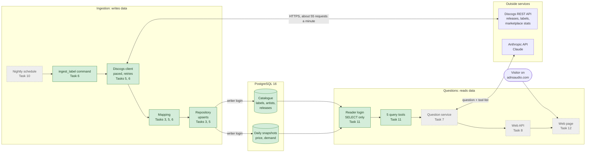
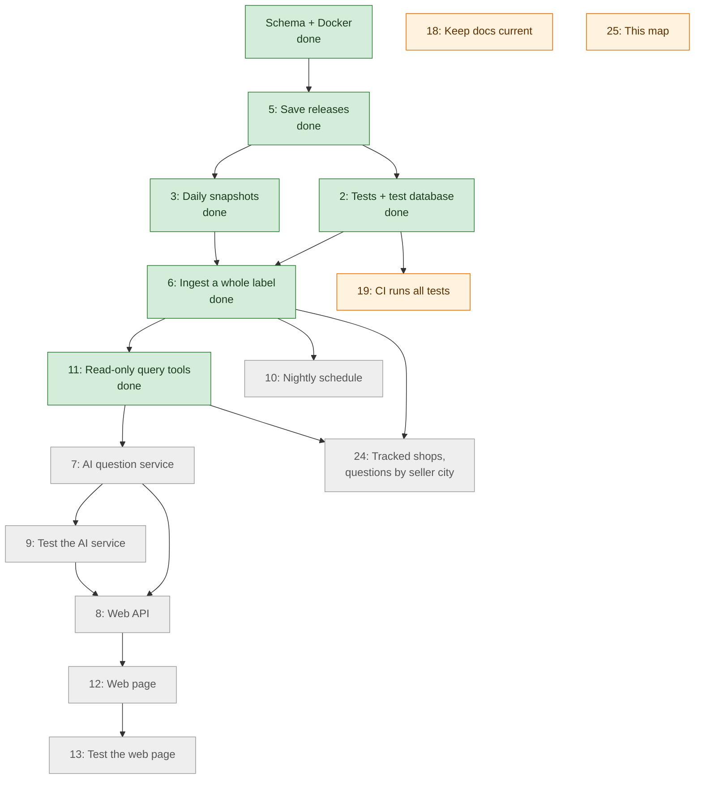
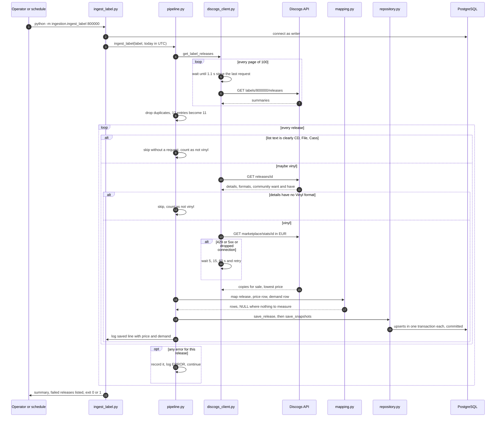
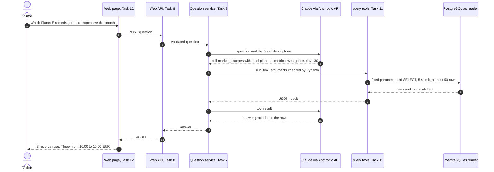

# Architecture and task map

How the project fits together, what each part is made of, and how it was built task by task, including the problems met on the way and how they were solved. This page is updated with every task. The reasoning behind each individual decision is in [decisions.md](decisions.md).

- **Everyone:** the diagrams, *In one sentence* lines and the problem log read without coding knowledge.
- **Developers:** the component table and the *Code* columns point to the exact files.

*Last updated: 1 November 2026, after task #11. 177 automated tests.*

**Legend used in the diagrams:** green = built and merged, grey = planned, orange = open follow-up.

---

## 1. The system at a glance

In one sentence: every night a Python job copies the vinyl releases of chosen labels, with that day's prices and demand, from Discogs into PostgreSQL; a read-only set of query tools lets an AI answer people's questions from that data.

Two separate logins protect the data. The **writer** (used only by ingestion) can change tables. The **reader** (used by everything a visitor can reach) can only read, and the database itself enforces that.

---

## 2. Task map

In one sentence: tasks are done in dependency order; each arrow means "needs this first".

| Task | Status | What it gives | Main tech |
| --- | --- | --- | --- |
| Schema + Docker | Done | The tables and a local PostgreSQL | SQL, Docker Compose |
| [#5](https://github.com/AntonisKol/music-catalogue-market-trends-wip/issues/5) Save releases | Done | One release with label and artists, saved repeatably | Python, psycopg, upserts |
| [#2](https://github.com/AntonisKol/music-catalogue-market-trends-wip/issues/2) Tests | Done | Fake Discogs, a throwaway test database | pytest, responses, Testcontainers |
| [#3](https://github.com/AntonisKol/music-catalogue-market-trends-wip/issues/3) Snapshots | Done | One price and demand row per release per day | Discogs marketplace API |
| [#6](https://github.com/AntonisKol/music-catalogue-market-trends-wip/issues/6) Pipeline | Done | A whole label in one command | logging, pacing, retries |
| [#11](https://github.com/AntonisKol/music-catalogue-market-trends-wip/issues/11) Query tools | Done | Safe, capped reads for the AI | PostgreSQL roles, Pydantic |
| [#7](https://github.com/AntonisKol/music-catalogue-market-trends-wip/issues/7) AI service | Next by priority | Questions answered from the data | Anthropic Messages API, tool use |
| [#9](https://github.com/AntonisKol/music-catalogue-market-trends-wip/issues/9) Test AI | Planned | Guardrails proven without live AI calls | pytest, mocks |
| [#8](https://github.com/AntonisKol/music-catalogue-market-trends-wip/issues/8) Web API | Planned | An HTTP endpoint for the page | Python web framework |
| [#12](https://github.com/AntonisKol/music-catalogue-market-trends-wip/issues/12) Web page | Planned | The question box on adnsaudio.com | HTML, CSS, JavaScript |
| [#13](https://github.com/AntonisKol/music-catalogue-market-trends-wip/issues/13) Test page | Planned | Keyboard, focus and screen-reader checks | browser tests |
| [#10](https://github.com/AntonisKol/music-catalogue-market-trends-wip/issues/10) Schedule | Planned | The pipeline runs every night | scheduler, logs |
| [#19](https://github.com/AntonisKol/music-catalogue-market-trends-wip/issues/19) CI | Open, P0 | Every PR runs all tests, including the database ones | GitHub Actions |
| [#24](https://github.com/AntonisKol/music-catalogue-market-trends-wip/issues/24) Tracked shops | Planned | Questions by seller city, e.g. Berlin | Discogs inventory API |
| [#18](https://github.com/AntonisKol/music-catalogue-market-trends-wip/issues/18) Docs | Ongoing | README kept in step with the roadmap | Markdown |
| [#20](https://github.com/AntonisKol/music-catalogue-market-trends-wip/issues/20), [#21](https://github.com/AntonisKol/music-catalogue-market-trends-wip/issues/21) | Covered by #6 | Vinyl filter; pacing of every request | to be closed |

---

## 3. One ingestion run, step by step

In one sentence: the command lists a label's releases, skips what is clearly not vinyl, and for each remaining release fetches details and prices, saves them, and commits before moving on.

---

## 4. A visitor's question, step by step (planned, tasks 7 to 12)

In one sentence: the AI never touches the database; it can only ask for one of five fixed tools, whose answers come back capped and are turned into a plain-language reply.

---

## 5. Components

| Part | Code | Tech | What it does | Safeguards |
| --- | --- | --- | --- | --- |
| Schema | [`db/schema.sql`](../db/schema.sql) | PostgreSQL 16 | Tables: labels, artists, releases, release_artists, price_snapshots, demand_snapshots | One snapshot per release per day (unique key) |
| Local database | [`docker-compose.yml`](../docker-compose.yml) | Docker Compose | Runs PostgreSQL on port 5432 and loads the schema on first start | Data kept in a named volume |
| Settings | [`ingestion/config.py`](../ingestion/config.py), [`queries/config.py`](../queries/config.py) | python-dotenv | Read `.env`; stop at once if a setting is missing | The web side never sees the Discogs token or the writer's password |
| Discogs client | [`ingestion/discogs_client.py`](../ingestion/discogs_client.py) | requests | Fetches releases, label pages and marketplace stats | 1.1 s between requests; retries 429, 5xx and dropped connections after 5, 15, 60 s; 30 s timeout |
| Mapping | [`ingestion/mapping.py`](../ingestion/mapping.py) | pure Python | Turns Discogs JSON into table rows; decides vinyl or not | No price stored as NULL, not 0; no ratings stored as NULL, not 0.0; exact decimal prices |
| Repository | [`ingestion/repository.py`](../ingestion/repository.py) | psycopg 3 | Saves releases and snapshots | Upserts, so a rerun updates instead of duplicating; one transaction per save |
| Single-release commands | [`save_release.py`](../ingestion/save_release.py), [`save_snapshot.py`](../ingestion/save_snapshot.py) | Python CLI | Save one release, or one release plus today's snapshot | Clear messages and exit codes |
| Label pipeline | [`ingestion/pipeline.py`](../ingestion/pipeline.py), [`ingest_label.py`](../ingestion/ingest_label.py) | Python CLI, logging | Ingests every vinyl release of a label | Duplicates dropped; failures listed and exit 1; commit per release; stops if the database connection is lost |
| Reader login | [`ingestion/create_reader_role.py`](../ingestion/create_reader_role.py) | PostgreSQL roles | Creates the SELECT-only login | Read-only sessions and a 5 s limit set on the role; future tables readable, never writable |
| Query tools | [`queries/tools.py`](../queries/tools.py), [`queries/database.py`](../queries/database.py) | Pydantic, psycopg | search_releases, rank_releases, release_history, market_changes, compare_labels | Validated arguments; fixed SQL; at most 50 rows with the total; wildcards escaped |
| Tests | [`tests/`](../tests) | pytest, responses, Testcontainers | 177 tests: fake Discogs, a throwaway PostgreSQL, a fake clock | Database tests skip without Docker on a laptop, fail in CI |

---

## 6. How problems are usually approached

The same routine has been used on every task:

1. **Check the facts at the source.** Before deciding, look at what the real system returns: call the live API, read the code, look at the database. Several decisions changed because of this, for example the rating endpoint turning out to have no want and have numbers.
2. **Separate the environment from the code.** When something fails, first find out whether it is our code, the machine (Docker, disk, settings) or the outside service.
3. **Lay out the options with their trade-offs.** Name two or three ways, what each costs, and what risk each leaves open. Pick one deliberately and record why (see [decisions.md](decisions.md)).
4. **Make the smallest change that solves it,** in the place where the problem belongs.
5. **Prove it with tests,** including the failure cases.
6. **Plant bugs on purpose.** Break the code in specific ways and check that a test fails each time; add a test whenever a planted bug survives.
7. **Run it for real.** A live run against Discogs and a throwaway database, before handing over.
8. **Write it down.** Update the README, decisions.md and this page, and raise anything outside the task's scope as its own ticket instead of fixing it on the side.

---

## 7. Problem log: what went wrong and what we did

| Task | Problem | Where it came from | What we did |
| --- | --- | --- | --- |
| #2 | Tests could not start on a fresh copy: the app stops when a setting is missing | Strict settings, which are deliberate | Tests set obviously fake settings themselves (`tests/conftest.py`); the app stayed strict |
| #2 | Docker could not start any container ("input/output error") | The Docker virtual machine (Colima) had disk errors and went read-only | Restarted Colima; recreated the local database container, which still pointed at the project's old Desktop folder; no data was lost |
| #2 | Testcontainers failed on this Mac | Its clean-up helper looks for the Docker socket at a path that does not exist inside Colima | Point it at the socket inside the virtual machine (`TESTCONTAINERS_DOCKER_SOCKET_OVERRIDE`) |
| #2 | A green test run could hide skipped database tests | Without Docker the database tests skip | Skip on a laptop, fail when `CI=true`; CI itself is ticket #19 |
| #3 | The Discogs documentation page refused automated reading | Discogs blocks scripted page requests | Called the live API with the project's own client and read the real answers |
| #3 | The release endpoint's price had no currency and ignored currency requests | How Discogs builds that response | Took prices from the marketplace stats endpoint, always in EUR |
| #3 | "No ratings" arrived as an average of 0.0 | Discogs' format | Stored as NULL (not rated), so averages are not dragged down |
| #3 | A bug-planting script reverted uncommitted work | Restoring files with git before committing | Re-applied the changes; since then work is committed before bugs are planted |
| #6 | A label list repeated releases (597 entries, 511 releases) | Discogs lists some releases twice | De-duplicated before fetching |
| #6 | Format text in label lists is loose and abbreviated | Discogs summary format | Skip only clear non-vinyl; let each release's details decide the rest |
| #6 | Saves were only committed at the end of a run | A read left a database transaction open, turning later saves into savepoints | Closed each read in its own transaction; a test checks releases are visible mid-run |
| #6 | Risk of hitting Discogs' rate limit | About 2 requests per release, 60 a minute allowed | Every request paced 1.1 s apart, temporary errors retried |
| #11 | A read-only session alone can be switched off | PostgreSQL session settings belong to the session | A separate SELECT-only login, with read-only sessions as a second lock |
| #11 | `%` and `_` typed by a user act as wildcards | SQL LIKE syntax | Escaped before matching; tests check they match literally |
| #11 | The live check showed releases filed under other labels | Discogs' label list includes releases where the label is only credited ("Recorded At"), and only the first label is stored | Documented; to be raised again before task #7 |
| Setup | Commands could not start on the owner's Mac | `.env` lacked most settings; an appended line was glued onto the previous one | Added the settings and split the glued line, without displaying any values |

---

## 8. Keeping this page current

Each task updates this page in the same pull request: the diagrams (status colours, new parts), the task table, the components table, and the problem log.
